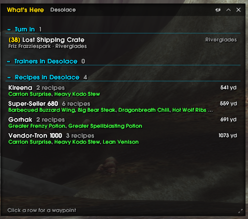

# What's Here

A WoW: Forever addon that lists quests you can turn in (all zones), plus profession trainers and recipe vendors worth visiting in your current zone. Click a row to set a waypoint.



**Download:** grab `WhatsHere-x.y.z.zip` from [Releases](../../releases), unzip it into `World of Warcraft/_forever_/Interface/AddOns/`, and restart the game. Requires **QuestieDB**.

Full description, dependencies and known limitations: [WhatsHere/README.md](WhatsHere/README.md).

## Repository layout

- `WhatsHere/`: the addon itself (this folder is what goes into `AddOns/`).
- `tools/`: offline test harness for luajit. It loads the real QuestieDB data outside the game and runs the addon against a mocked WoW UI:

  ```
  cd tools
  NAOWH=<path to NaowhForever_Professions> luajit addontest.lua <path to QuestieDB> "$PWD" ../WhatsHere/WhatsHere.lua <uiMapId>
  ```

  `encoding.lua` emulates `C_EncodingUtil` (base64, zlib via the luajit FFI, CBOR), so libz must be installed.
